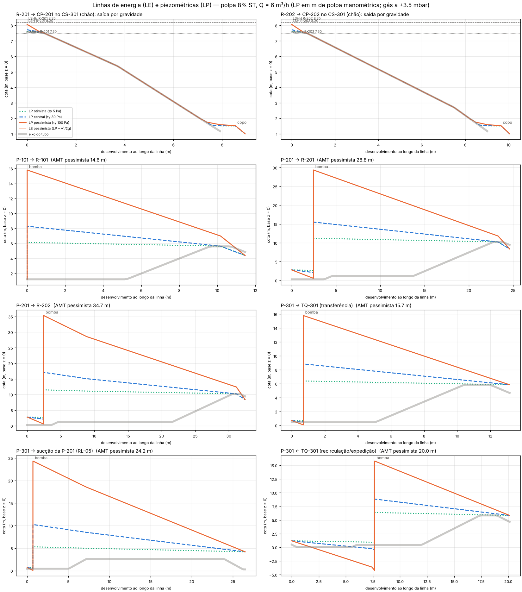

# Memória hidráulica — cascata Gen E com polpa de 8% ST (documento de trabalho)

Situação: **PROPOSTA DE TRABALHO, NÃO LIBERADA.** Revisão 3, depois de três rodadas do Crivo A–F independente (bloqueantes das rodadas 1 e 2 tratados aqui); liberada para circular em discussão, não para emissão. Cotas na base comum z = 0 (premissa de S5). Sem valores monetários.

## 1. Premissas e método

- **Vazão de projeto das saídas: 6 m³/h.** É a vazão máxima das PCP de alimentação (2–6 m³/h); em regime, o que entra sai. A verificação a 20 m³/h só mostra folga, porque retiradas são bombeadas.
- **Reologia:** plástico de Bingham.
  - Tubo cheio: Buckingham–Reiner e Darby–Mun–Boger.
  - Partida: 4·τy·L/(ρ·g·D).
  - Lâmina livre: sen θ ≥ τy/(ρ·g·0,304·D).
  - **Singulares pelo 2-K de Hooper com o Re de Metzner–Reed** (8ρv²/τw), não com o Re de Bingham. Em polpa com τy cada curva de 90° custa K1·τw/(16ρg): da ordem de 0,5 m com 100 Pa, quase independente do diâmetro.
  - Consequência de projeto: **nenhuma curva cheia nas saídas por gravidade.** Bocal no nível, descidas livres e pote de selagem com tubo mergulhado reto.
- **Três casos de reologia.** São HIPÓTESE até a reometria da polpa real (LAC-041, proposta):

| caso | τy (Pa) | μp (Pa·s) | ρ (kg/m³) |
|---|---|---|---|
| otimista | 5 | 0,02 | 1030 |
| central | 30 | 0,06 | 1030 |
| pessimista | 100 | 0,20 | 1030 |

- **Espaço de gás:** opera de +1,5 a +3,5 mbar. As verificações de nível usam 0 mbar (partida, conservador), e o gráfico usa a operação.
- **NPSH:** P_atm 91,3 kPa no sítio de referência (Congonhas/MG, ≈ 870 m; RES-001 §5.5, a confirmar na LAC-027) e P_vapor 5,6 kPa (35 °C).
- **Pote de selagem, virada de 180° no fundo:** modelada como 0.30 m de caminho equivalente no ânulo. É estimativa de engenharia, a confirmar na reometria ou em ensaio de bancada (LAC-041).

## 2. Saídas por gravidade (N-SAI no nível → descida livre → pote de selagem → destino)

Arranjo de cada saída:
- **N-SAI:** bocal novo DN150 com a soleira interna no N.A. de projeto (a mesma cota da tabela de níveis).
- **Descida:** registro LO (faca), depois descida com lâmina livre, com sen θ de 0,31 a 0,50 (mínimo exigido no caso pessimista: 0,23).
- **Pote de selagem:** ao chegar, a descida vira tubo mergulhado DE160 até 330 mm abaixo da soleira do vertedor do pote. O pote transborda por lâmina livre ao destino.
- **Quebra-sifão: respiro de equalização R-xxx-RS (DE90).** Ele sai da geratriz superior da descida, logo depois do registro LO, e vai a um N1 do tampo, com faca DN80 LO presa à mesma chave da V-xSAI e do dreno do pote (na manutenção, as duas fecham antes de drenar o pote). O bocal no nível sozinho não basta. Com τy alto, o nível sobe acima do topo do N-SAI (0,2 a 0,5 m na soleira), em operação e também em repouso, e o bocal fica afogado.
  - Sem respiro, o bolsão de gás da descida se dissolve ou é arrastado pela polpa, a descida enche e sifona o reator até o topo do bocal. Isso retira 2,6 a 3,8 m³ de um reator fechado e cria vácuo.
  - Com o respiro, a descida fica sempre à pressão do gás e nada abaixo da soleira escoa por gravidade. O fecho hídrico é a superfície interna do pote.

Colunas da tabela:
- **Subida na soleira:** lâmina crítica + partida no trecho horizontal + entrada + registro.
- **Carga no pote:** superfície interna menos a soleira do vertedor. Soma a lâmina do vertedor, o tubo mergulhado (atrito + saída) e o ânulo (partida).
- **Folga na soleira:** soleira do N-SAI menos a superfície interna do pote. Se for negativa, o pote afoga a saída e o nível do reator sobe junto.

| reator | caso | Q (m³/h) | subida na soleira (m) | nível máx. (m) | folga até LSH (m) | carga no pote (m) | folga na soleira (m) | sen θ mín. exigido | sen θ adotado | selo (mm / mbar) |
|---|---|---|---|---|---|---|---|---|---|---|
| R-101 | otimista | 6 | 0,06 | 3,56 | 0,64 | 0,06 | 0,95 | 0,012 | 0,50 | 330 / 33 |
| R-201 | otimista | 6 | 0,06 | 7,56 | 0,64 | 0,06 | 1,10 | 0,012 | 0,37 | 330 / 33 |
| R-202 | otimista | 6 | 0,06 | 7,56 | 0,64 | 0,06 | 1,19 | 0,012 | 0,31 | 330 / 33 |
| R-101 | otimista | 20 | 0,10 | 3,60 | 0,60 | 0,10 | 0,91 | 0,012 | 0,50 | 330 / 33 |
| R-201 | otimista | 20 | 0,10 | 7,60 | 0,60 | 0,11 | 1,05 | 0,012 | 0,37 | 330 / 33 |
| R-202 | otimista | 20 | 0,10 | 7,60 | 0,60 | 0,11 | 1,14 | 0,012 | 0,31 | 330 / 33 |
| R-101 | central | 6 | 0,18 | 3,68 | 0,52 | 0,18 | 0,83 | 0,069 | 0,50 | 330 / 33 |
| R-201 | central | 6 | 0,19 | 7,69 | 0,51 | 0,18 | 0,98 | 0,069 | 0,37 | 330 / 33 |
| R-202 | central | 6 | 0,19 | 7,69 | 0,51 | 0,18 | 1,07 | 0,069 | 0,31 | 330 / 33 |
| R-101 | central | 20 | 0,23 | 3,73 | 0,47 | 0,23 | 0,78 | 0,069 | 0,50 | 330 / 33 |
| R-201 | central | 20 | 0,23 | 7,73 | 0,47 | 0,23 | 0,93 | 0,069 | 0,37 | 330 / 33 |
| R-202 | central | 20 | 0,23 | 7,73 | 0,47 | 0,24 | 1,01 | 0,069 | 0,31 | 330 / 33 |
| R-101 | pessimista | 6 | 0,53 | 4,03 | 0,17 | 0,66 | 0,35 | 0,231 | 0,50 | 330 / 33 |
| R-201 | pessimista | 6 | 0,54 | 8,04 | 0,16 | 0,66 | 0,50 | 0,231 | 0,37 | 330 / 33 |
| R-202 | pessimista | 6 | 0,54 | 8,04 | 0,16 | 0,66 | 0,59 | 0,231 | 0,31 | 330 / 33 |
| R-101 | pessimista | 20 | 0,59 | 4,09 | 0,11 | 0,76 | 0,25 | 0,231 | 0,50 | 330 / 33 |
| R-201 | pessimista | 20 | 0,60 | 8,10 | 0,10 | 0,77 | 0,39 | 0,231 | 0,37 | 330 / 33 |
| R-202 | pessimista | 20 | 0,60 | 8,10 | 0,10 ⚠ | 0,77 | 0,48 | 0,231 | 0,31 | 330 / 33 |

Conclusões das saídas:

1. A saída por gravidade de polpa a 8% ST funciona a 6 m³/h nos três casos de reologia, com este arranjo.
   - Menor folga entre a superfície do pote e a soleira: R-101 0,35 m (pessimista); R-201 0,50 m (pessimista); R-202 0,59 m (pessimista).
   - O nível máximo fica abaixo do LSH em todos os casos.
   - **Divergência do arranjo anterior:** o U de fecho e o standpipe submerso foram abandonados. Com τy alto, as curvas cheias deles faziam o nível passar do LSHH.
2. **Selo de 330 mm de polpa (≈ 33 mbar).** É 2,7× a abertura da emergência (+12 mbar) e 4× o envelope de vácuo dos R-201/202 (−8 mbar). O R-101 tem envelope de −6 mbar e emergência de −4/−5. Também passa os ≥ 250 mm da RES-001 LQ-04.
   - Sob +12 mbar, a superfície interna do pote desce 0,12 m e o tubo mergulhado continua 0,21 m afogado.
   - A proposta citava 500 mmCA: **divergência a validar pelo responsável de processo.**
3. Q = 20 m³/h por gravidade não ocorre, porque as PCP não entregam essa vazão. A linha aparece só como folga.
4. **Arraste de biogás pelo selo.** Bolhas retidas na polpa (τy de 30–100 Pa) podem passar pelo tubo mergulhado ao ânulo do pote e seguir pela linha de transbordo aos tanques atmosféricos.
   - Os respiros do TQ-201 (FCA-201) e do TQ-301 (A7, sem tratamento) passam a receber CH₄/H₂S.
   - Estimar a vazão arrastada e tratá-la na classificação de área e no tratamento dos respiros (LAC-049).

## 3. Alças de entrada e demais trens bombeados (Q = 6 m³/h)

Funcionamento das alças:
- As alças são pressurizadas, com crista em LSHH + 1,0 m.
- Uma ventosa de esgoto (corpo longo) fica na crista e descarrega no espaço de gás do reator por um N1.
- **Com τy baixo:** a descida perde pouco, a crista fica sob a pressão do gás e a ventosa admite gás (não ar). A descida trabalha livre.
- **Com τy alto:** a PCP pressuriza a descida em DE160 até o N2.
- Em qualquer caso a crista acima do nível impede o sifonamento do reator de volta pela alça.
- A alimentação dos R-201/R-202 é **alternada** pelas V-201AL e V-202BQ atuadas, intertravadas para nunca ficarem abertas juntas: não há rateio em paralelo.
  - O ramal parado (até ≈ 34 m no R-202-AL) envelhece e ganha τy. Alternar com frequência e lavar com água antes de longas paradas. A AMT pessimista já cobre a partida com τy = 100 Pa.
- **Ventosa com τy baixo:** a ventosa da crista cicla (descida livre). Especificar ventosa de esgoto de corpo longo, com manutenção programada, e ZSC/inspeção no plano de manutenção.

| trem | caso | perda sucção (m) | perda recalque (m) | AMT (m) | AMT (bar) | pressão na crista (m) | p. sucção no flange (m) | NPSHd (m) |
|---|---|---|---|---|---|---|---|---|
| P-101 → R-101 | otimista | 0,00 | 0,64 | 4,62 | 0,47 | 0,03 | — | — |
| P-201 → R-201 | otimista | 0,06 | 0,87 | 9,12 | 0,92 | 0,03 | 0,16 | 8,64 |
| P-201 → R-202 | otimista | 0,06 | 1,46 | 9,68 | 0,98 | 0,03 | 0,16 | 8,64 |
| P-301 → TQ-301 (recirculação) | otimista | 0,19 | 0,74 | 8,38 | 0,85 | — | 0,56 | 9,04 |
| P-301 → TQ-201 (RL-05) | otimista | 0,19 | 1,19 | 3,67 | 0,37 | — | 0,56 | 9,04 |
| Purga R-201 → P-301 | otimista | 0,41 | 0,74 | 2,27 | 0,23 | — | 6,67 | 15,15 |
| Purga R-101 → P-201 | otimista | 0,32 | 0,87 | 6,77 | 0,68 | 0,03 | 2,51 | 10,99 |
| P-101 → R-101 | central | 0,00 | 3,43 | 6,61 | 0,67 | 0,14 | — | — |
| P-201 → R-201 | central | 0,34 | 4,67 | 12,48 | 1,26 | 0,51 | -0,12 | 8,36 |
| P-201 → R-202 | central | 0,34 | 7,89 | 15,70 | 1,59 | 0,69 | -0,12 | 8,36 |
| P-301 → TQ-301 (recirculação) | central | 1,09 | 4,11 | 12,65 | 1,28 | — | -0,34 | 8,14 |
| P-301 → TQ-201 (RL-05) | central | 1,09 | 6,41 | 9,80 | 0,99 | — | -0,34 | 8,14 |
| Purga R-201 → P-301 | central | 2,38 | 4,11 | 7,61 | 0,77 | — | 4,70 | 13,18 |
| Purga R-101 → P-201 | central | 1,86 | 4,67 | 11,38 | 1,15 | 0,51 | 0,98 | 9,46 |
| P-101 → R-101 | pessimista | 0,00 | 11,36 | 14,54 | 1,47 | 2,70 | — | — |
| P-201 → R-201 | pessimista | 1,14 | 15,48 | 24,09 | 2,43 | 3,91 | -0,92 | 7,56 |
| P-201 → R-202 | pessimista | 1,14 | 26,20 | 34,81 | 3,52 | 4,52 | -0,92 | 7,56 |
| P-301 → TQ-301 (recirculação) | pessimista | 3,63 | 13,67 | 24,76 | 2,50 | — | -2,88 | 5,60 |
| P-301 → TQ-201 (RL-05) | pessimista | 3,63 | 21,29 | 27,23 | 2,75 | — | -2,88 | 5,60 |
| Purga R-201 → P-301 | pessimista | 7,94 | 13,67 | 22,73 | 2,30 | — | -0,85 | 7,63 |
| Purga R-101 → P-201 | pessimista | 6,19 | 15,48 | 26,52 | 2,68 | 3,91 | -3,35 | 5,13 |

Leitura da tabela:

- **Maior AMT:** P-201 → R-202, caso pessimista, com 3,52 bar.
  - Especificar as PCP P-201 e P-301 com ≥ 2 estágios.
  - **PSV (ou disco de ruptura com retorno) e PSHH com trip na descarga, antes de qualquer válvula** (RES-001 VC-10/LQ-01). A PCP fechada contra uma válvula passa da classe do PEAD SDR17.
- **Pressão na crista:** igual à do gás nos casos de τy baixo, quando a ventosa abre; positiva quando a descida é pressurizada.
- **Pressão na sucção:** fica negativa com τy alto. O pior caso é Purga R-101 → P-201, pessimista, com -3,35 m. O menor NPSH disponível é 5,13 m (Purga R-101 → P-201, pessimista).
  - Especificar PCP com NPSHr ≤ 3 m.
  - Sucção toda em PEAD soldado e selo mecânico com flush, porque a sucção em vácuo admite ar por juntas e selo, e a ventosa leva esse ar ao espaço de gás.
  - A sucção da P-201 é reta, sem curvas, com a bomba alinhada ao N-SUC.
  - Nas purgas, a sucção depende do nível do reator: PSL na sucção.
- **Purgas:** registro LC + XV falha-fecha no N2, e chave presa entre V-xPG e a sucção do tanque (V-201S / V-301S).
  - A chave é única para V-201PG/V-202PG: um reator por vez, sem interligar os dois pelo fundo.
  - Na purga dos R-201/202 pela P-301, a crista da L-301R fica acima do LSHH dos reatores e tem ventosa (quebra-vácuo a ar, lado atmosférico). Com a PCP parada ou gasta, o reator não sifona pela bomba: a AMT da purga é positiva.
  - A XV abre só com os permissivos da RES-001 §5.6: PALL, ZSC do gás, LSL do reator, LSHH do destino e PSL da sucção. Ela fecha no trip da bomba.

## 4. TQ-201 (neutralização): Ø1,80 m, fundo a +0,45, sucção a +0,70

| nível | cota (m) | volume (m³) |
|---|---|---|
| LSLL | 0,92 | 1,20 |
| LSL | 1,07 | 1,58 |
| LSH | 1,45 | 2,54 |
| LSHH | 1,60 | 2,93 |
| extravasor | 1,85 | 3,56 |
| entrada | 2,31 | 4,73 |

- **Volume útil** LSL→LSH: 0,97 m³. Detenção até o LSH a 6 m³/h: 25 min (neutralização: 10–30 min usuais).
- **Submergência da sucção (HI 9.8):** o LSLL fica ≥ 0,15 m acima do topo do bocal N-SUC. O pulmão LSH→LSHH é de 3,8 min.
- **Volume que ainda chega depois do trip** (o reator escoa até a soleira, caso otimista), contra o volume LSHH→extravasor:
  - R-101 → TQ-201: 0,50 m³ contra 0,64 m³;
  - R-201 ou R-202 → TQ-301 (alimentação alternada: um reator por vez): 0,72 m³ contra 1,06 m³.
  - O caso otimista é o pior, porque com τy alto parte do volume fica retida no reator em repouso.
  - Com o extravasor do TQ-201 a +1,85 m, os dois volumes cabem e o extravasor não opera num trip normal.
  - O LSHH do TQ-201 também corta a P-301 (RL-05).

## 5. Linhas de energia e piezométricas

- **Lâmina livre:** a LP coincide com a superfície da polpa.
- **No pote:** a LP cai pelo tubo mergulhado e pelo ânulo até o vertedor.
- **Velocidade:** de 0,1 a 0,4 m/s, então v²/2g < 1 cm e a LE se sobrepõe à LP.
- **Bombas:** a LP sobe na bomba (AMT) e cai com o atrito.
- **Alças:** a LP fica no mínimo na crista mais o gás, porque a ventosa admite gás quando cai abaixo disso.

## 6. Lacunas

As lacunas propostas (LAC-041 a LAC-049) estão em `LACUNAS_PROPOSTAS.md`. As que decidem este cálculo:
- **LAC-041:** reometria da polpa e ensaio do pote.
- **LAC-027/045:** sítio e base z = 0.
- **LAC-046:** selo de 330 mm.
- **LAC-049:** biogás arrastado aos respiros dos tanques atmosféricos.
